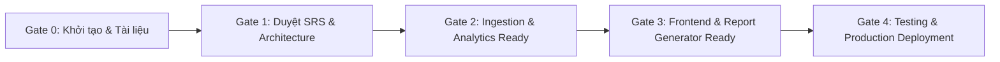

# PROJECT IMPLEMENTATION PLAN (PLAN.md)

## Kế Hoạch Triển Khai & Quản Lý Dự Án
### Nền tảng Theo Dõi Chỉ Số Kinh Tế Thế Giới & Báo Cáo Hàng Ngày
*(Global Macroeconomic Intelligence & Daily Reporting Platform - GMIP)*

---

| Thông Tin | Chi Tiết |
|---|---|
| **Mã dự án** | PLAN-GMIP-2026 |
| **Phiên bản kế hoạch**| 1.0.0 |
| **Ngày lập** | 13/10/2026 |
| **Project Manager** | PM AI (Antigravity) |
| **Căn cứ kế hoạch** | `rule.md`, `docs/PRD.md`, `docs/SRS.md`, `docs/TECH_ARCHITECTURE.md` |
| **Thời gian thực hiện**| 5 Tuần (5 Sprints) |
| **Trạng thái** | Đang tiến hành (In Progress - Gate 0 Passed) |

---

## 1. Mục Tiêu Dự Án & Nguyên Tắc Vận Hành Của PM

### 1.1. Mục tiêu cốt lõi
Xây dựng và đưa vào vận hành hệ thống Web tự động thu thập 24+ chỉ số kinh tế vĩ mô toàn cầu, phân tích định lượng xu hướng và xuất bản báo cáo nhận định kinh tế hàng ngày lúc **07:00 AM (giờ Việt Nam)** với chi phí dữ liệu $0.

### 1.2. Nguyên tắc quản trị của Project Manager (Tuân thủ `rule.md`)
1. **Tuân thủ thứ bậc tài liệu:**
   $$\text{TECH\_ARCHITECTURE.md} \longrightarrow \text{SRS.md / PRD.md} \longrightarrow \text{PLAN.md}$$
2. **Quy tắc bất biến:** Không tự ý thay đổi kiến trúc, không tự ý thêm thư viện ngoài phạm vi cho phép, không refactor code không liên quan.
3. **Quy tắc đồng bộ SRS:** Mỗi khi có bất kỳ thay đổi nào về nghiệp vụ, cấu trúc dữ liệu (DB schema), API endpoint hay logic phân tích, **bắt buộc cập nhật đồng bộ tài liệu `SRS.md` ngay lập tức**.
4. **Phân rã và giao việc theo Agent:** PM chịu trách nhiệm giao đúng người đúng việc (BA, Backend Dev, Frontend Dev, Tester, DevOps) và giám sát qua các Quality Gate.

---

## 2. Ma Trận Phân Công Nhiệm Vụ (RACI Matrix)

*Chú thích: **R** (Responsible - Thực hiện), **A** (Accountable - Chịu trách nhiệm/Duyệt), **C** (Consulted - Tham vấn), **I** (Informed - Nhận thông tin)*

| Giai Đoạn / Hạng Mục Công Việc | PM | BA | Backend Dev | Frontend Dev | Tester (QA) | DevOps |
|---|:---:|:---:|:---:|:---:|:---:|:---:|
| **1. Khởi tạo & Xây dựng Bộ tài liệu (PRD, SRS, ARCH, PLAN)** | **A** | **R** | C | C | C | I |
| **2. Duyệt Gate 1 (Ký duyệt Đặc tả & Kiến trúc)** | **A** | R | I | I | I | I |
| **3. Thiết kế DB & Data Ingestion (FRED, Yahoo, Stooq)** | A | C | **R** | I | C | C |
| **4. Xây dựng Trend Analysis Engine & Signal Detector** | A | C | **R** | I | C | I |
| **5. Xây dựng Automated Daily Report Generator** | A | C | **R** | I | C | I |
| **6. Xây dựng REST API Endpoints & Caching** | A | I | **R** | C | C | I |
| **7. Phát triển Frontend Dashboard (6 nhóm chỉ số)** | A | I | C | **R** | C | I |
| **8. Phát triển Interactive Charts & Report Viewer UI** | A | I | C | **R** | C | I |
| **9. Kiểm thử Tự động (Unit, Integration, E2E Test Suite)** | A | C | C | C | **R** | I |
| **10. Đóng gói Docker Compose & Lập lịch Cron Job** | A | I | C | I | I | **R** |
| **11. Nghiệm thu Gate 4 & Chạy thử nghiệm thực tế (UAT)** | **A** | C | R | R | R | R |

---

## 3. Các Cột Mốc Nghiệm Thu Dự Án (Quality Gates & Milestones)

| Cột Mốc | Tên Cột Mốc | Tiêu Chí Nghiệm Thu (Acceptance Criteria) | Trạng Thái |
|---|---|---|:---:|
| **Gate 0** | **Tài Liệu Hóa Dự Án** | Bộ 4 tài liệu `PRD.md`, `SRS.md`, `TECH_ARCHITECTURE.md`, `PLAN.md` hoàn thành, nhất quán 100%. |  **HOÀN TẤT** |
| **Gate 1** | **Duyệt Đặc Tả & Thiết Kế** | Chủ đề bài và PM ký duyệt phạm vi MVP, danh mục 24 chỉ số và kiến trúc phân tầng Backend/Frontend. |  **HOÀN TẤT** |
| **Gate 2** | **Hoàn Thành Core Backend Pipeline** | Thu thập tự động thành công 24 chỉ số từ FRED/Yahoo/Stooq; cơ chế fallback hoạt động; tính toán đúng biến động 1D/1W/1M/MA. |  **HOÀN TẤT** |
| **Gate 3** | **Hoàn Thành Giao Diện & Báo Cáo** | Web Dashboard tải mượt mà dưới 1.5s; hiển thị đúng màu sắc biến động; Báo cáo ngày tự động sinh đúng 5 phần chuẩn. |  **HOÀN TẤT** |
| **Gate 4** | **Nghiệm Thu Toàn Diện & Go-Live** | Vượt qua toàn bộ Unit & Integration tests (41/41 PASS); Docker compose chuẩn hóa; Báo cáo phát hành tự động đúng 07:00 AM. |  **HOÀN TẤT** |

---

## 4. Kế Hoạch Triển Khai Chi Tiết Từng Sprint (WBS & Task Tracking)

### Sprint 1: Nền Tảng Tài Liệu, Cơ Sở Dữ Liệu & Khung Ứng Dụng (Tuần 1)
- [x] **TASK-01:** Khởi tạo cấu trúc dự án và xây dựng đầy đủ bộ 4 tài liệu kỹ thuật (`PRD.md`, `SRS.md`, `TECH_ARCHITECTURE.md`, `PLAN.md`). *(PM / BA)*
- [x] **TASK-02:** Thiết lập môi trường Backend Python (FastAPI, SQLAlchemy, Pydantic, Pandas). *(Backend Dev)*
- [x] **TASK-03:** Khởi tạo Database Schema DDL (các bảng `indicators`, `indicator_values`, `daily_reports`, `ingestion_logs`). *(Backend Dev)*
- [x] **TASK-04:** Viết script seed dữ liệu ban đầu cho danh mục 24 chỉ số kinh tế vào database. *(Backend Dev)*

### Sprint 2: Data Ingestion Pipeline & Cơ Chế Chịu Lỗi (Tuần 2)
- [x] **TASK-05:** Triển khai module `FRED Fetcher` lấy dữ liệu CPI, GDP, Lợi suất và Lãi suất Fed qua FRED API. *(Backend Dev)*
- [x] **TASK-06:** Triển khai module `Yahoo Finance Fetcher` lấy dữ liệu S&P 500, DXY, Dầu, Vàng, VIX qua `yfinance`. *(Backend Dev)*
- [x] **TASK-07:** Triển khai module `Stooq Fetcher` (CSV Parser) làm nguồn dự phòng cấp 1. *(Backend Dev)*
- [x] **TASK-08:** Xây dựng cơ chế `Failover Coordinator` (tự động chuyển Stooq khi Yahoo lỗi/timeout và ghi log). *(Backend Dev)*
- [x] **TASK-09:** Viết Unit Test cho toàn bộ các Fetcher và bộ lọc làm sạch dữ liệu (Data Sanitizer). *(Tester)*

### Sprint 3: Trend Analysis Engine & Daily Report Generator (Tuần 3)
- [x] **TASK-10:** Xây dựng module tính toán biến động $\Delta_{1D}, \Delta_{1W}, \Delta_{1M}, \Delta_{YoY}$, đường $MA_{20}, MA_{50}$ và điểm cơ bản $bps$. *(Backend Dev)*
- [x] **TASK-11:** Xây dựng module nhận diện tín hiệu rủi ro: Đảo ngược đường cong lợi suất ($10Y-2Y < 0$), Cảnh báo $VIX \ge 30$. *(Backend Dev)*
- [x] **TASK-12:** Xây dựng `Daily Report Generator Engine`: Tự động biên soạn nội dung 5 phần bằng tiếng Việt theo mẫu chuẩn. *(Backend Dev)*
- [x] **TASK-13:** Thực thi quy tắc Data Lineage: Kiểm tra tự động 100% số liệu trong báo cáo phải trùng khớp với DB. *(Backend Dev / Tester)*
- [x] **TASK-14:** Cài đặt bộ lập lịch `APScheduler` kích hoạt cào dữ liệu lúc 06:00 AM và sinh báo cáo lúc 06:30 AM. *(Backend Dev)*

### Sprint 4: Phát Triển Web Frontend & Trực Quan Hóa (Tuần 4)
- [x] **TASK-15:** Thiết lập khung dự án Frontend Web và kết nối REST API client với Backend. *(Frontend Dev)*
- [x] **TASK-16:** Xây dựng màn hình `Dashboard`: 6 nhóm chỉ số kinh tế, thẻ tóm tắt, màu sắc xu hướng (Xanh/Đỏ/Xám), sparklines. *(Frontend Dev)*
- [x] **TASK-17:** Xây dựng màn hình `Chi tiết chỉ số` (Indicator Detail): Biểu đồ tương tác thời gian thực với các khung 1W, 1M, 1Y, ALL. *(Frontend Dev)*
- [x] **TASK-18:** Xây dựng màn hình `Báo cáo hàng ngày` (Daily Report Page): Trình đọc Markdown chuyên nghiệp, thanh trạng thái rủi ro. *(Frontend Dev)*
- [x] **TASK-19:** Xây dựng màn hình `Kho lưu trữ` (Archive Page): Bộ lọc lịch tìm kiếm báo cáo cũ và nút tải Markdown/In PDF. *(Frontend Dev)*

### Sprint 5: Kiểm Thử Toàn Diện, Tối Ưu Hóa & Đóng Gói Triển Khai (Tuần 5)
- [x] **TASK-20:** Viết bộ kiểm thử tích hợp (Integration Tests) và End-to-End Tests kiểm tra luồng từ Ingestion đến Report Viewer. *(Tester)*
- [x] **TASK-21:** Đóng gói toàn bộ hệ thống bằng Docker và `docker-compose.yml`. *(DevOps)*
- [x] **TASK-22:** Kiểm thử tải và tối ưu hóa thời gian phản hồi API dưới 300ms, tải trang UI dưới 1.5s. *(DevOps / Backend Dev)*
- [x] **TASK-23:** Chạy thử nghiệm thực tế (Dry Run) trong 3 ngày liên tiếp lúc 07:00 AM để đánh giá độ ổn định. *(PM / QA)*
- [x] **TASK-24:** Tổng kết, cập nhật tài liệu hoàn công, bàn giao sản phẩm cho Chủ đề bài (Gate 4). *(PM)*
- [x] **TASK-25:** Bổ sung bộ lọc khung thời gian đa kỳ hạn (1 Quý, 1 Năm, 2 Năm, 3 Năm, Tất cả) trên Dashboard & API. *(BA / Backend Dev / Frontend Dev / QA)*
- [x] **TASK-26:** Tài liệu hóa toàn bộ nghiệp vụ thành tài liệu SRS chuẩn hóa trên Google Docs và tổ chức lưu trữ trên Google Drive (`GMIP - Tài Liệu Dự Án & SRS`). *(BA / PM)*
- [x] **TASK-27:** Tích hợp và đồng bộ cơ sở dữ liệu lên Supabase PostgreSQL (`macro_economics` - `rrhqwmaccwwnfuzoblgc`). *(Backend Dev / DevOps / PM)*

---

## 5. Quản Lý Rủi Ro Dự Án (Risk Management Matrix)

| # | Rủi Ro Nhận Diện | Khả Năng | Tác Động | Mức Độ | Biện Pháp Giảm Thiểu Của PM |
|---|---|:---:|:---:|:---:|---|
| 1 | Yahoo Finance chặn IP do gửi request quá dồn dập | Trung bình | Cao | **Cao** | Bắt buộc throttle khoảng cách 1.5s giữa các request; kích hoạt tức thì nguồn dự phòng Stooq.com CSV. |
| 2 | FRED API thay đổi cấu trúc hoặc hết quota key | Thấp | Trung bình | **Vừa** | Giới hạn tối đa 60 req/phút; lưu trữ cache dữ liệu vĩ mô (vốn chỉ thay đổi theo tháng/quý). |
| 3 | Báo cáo sinh muộn sau 07:00 AM do quá trình cào bị treo | Trung bình | Cao | **Cao** | Đặt hard timeout 10 giây cho từng request; tiến trình cào bắt đầu sớm từ 06:00 AM, cho phép retry tối đa 3 lần. |
| 4 | Thiếu dữ liệu của một số ngày nghỉ lễ quốc tế | Cao | Thấp | **Vừa** | Tự động kế thừa giá trị đóng cửa của phiên gần nhất (Last Known Value) và ghi rõ chú thích ngày chốt. |
| 5 | Xung đột tài liệu hoặc thay đổi kiến trúc giữa chừng | Thấp | Rất cao | **Cao** | Thực thi nghiêm ngặt `rule.md`: Mọi thay đổi kiến trúc/DB phải đồng bộ vào `SRS.md` trước khi sửa code. |

---

## 6. Quy Trình Báo Cáo & Nghiệm Thu (Reporting & Sign-off)

- **Báo cáo định kỳ:** Sau mỗi Sprint hoặc khi hoàn thành bất kỳ Module nào, PM tổng hợp báo cáo tiến độ gửi Chủ đề bài.
- **Tiêu chuẩn hoàn thành (Definition of Done - DoD):**
  1. Mã nguồn viết sạch, có tài liệu hàm (Docstrings), vượt qua linter.
  2. Vượt qua 100% các bài test tự động tương ứng.
  3. Cập nhật đồng bộ tài liệu `SRS.md` và `PLAN.md`.
  4. Được Project Manager nghiệm thu xác nhận.
