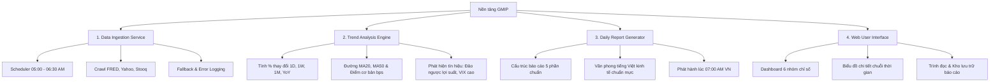

# PRODUCT REQUIREMENTS DOCUMENT (PRD)

## Nền tảng Theo Dõi Chỉ Số Kinh Tế Thế Giới & Báo Cáo Hàng Ngày
*(Global Macroeconomic Intelligence & Daily Reporting Platform - GMIP)*

---

| Thông Tin | Chi Tiết |
|---|---|
| **Mã dự án** | GMIP-2026 |
| **Phiên bản tài liệu** | 1.0.0 |
| **Ngày ban hành** | 13/10/2026 |
| **Người phê duyệt** | Project Manager & Chủ đề bài |
| **Trạng thái** | Chính thức (Approved for MVP) |

---

## 1. Tổng Quan & Tầm Nhìn Sản Phẩm

### 1.1. Bối cảnh thị trường & Nỗi đau của người dùng (Problem Statement)
Trong kỷ nguyên tài chính hiện đại, các biến động kinh tế vĩ mô toàn cầu (lạm phát Mỹ, quyết định lãi suất của Fed, lợi suất trái phiếu chính phủ, giá dầu, vàng, tỷ giá USD...) tác động trực tiếp và tức thì đến thị trường tài chính và kinh doanh tại Việt Nam.

Tuy nhiên, việc nắm bắt thông tin kinh tế hàng ngày hiện đang đối mặt với nhiều rào cản:
1. **Phân mảnh thông tin:** Dữ liệu nằm rải rác ở hàng chục website khác nhau (FRED, Yahoo Finance, Trading Economics, Investing, Bloomberg, Reuters...).
2. **Tốn thời gian & công sức:** Mỗi buổi sáng, người dùng phải tự mở nhiều tab, tra cứu thủ công từng con số, tự ghép nối và tính toán biến động.
3. **Chi phí cao:** Các dịch vụ terminal chuyên nghiệp (Bloomberg, Refinitiv) có giá hàng chục nghìn USD/năm, không phù hợp cho cá nhân hoặc doanh nghiệp vừa và nhỏ.
4. **Thiếu tính tổng hợp & nhận định:** Dữ liệu thô thiếu góc nhìn tổng quan; các báo cáo thị trường có sẵn thường bị chậm trễ hoặc viết bằng tiếng Anh với thuật ngữ phức tạp.

### 1.2. Mục tiêu sản phẩm (Product Objectives)
Xây dựng một nền tảng Web tự động hóa 100% quy trình:
- **Tự động thu thập** các chỉ số kinh tế vĩ mô, tài chính và hàng hóa quan trọng từ các nguồn mở miễn phí trên internet.
- **Tự động phân tích** xu hướng biến động (theo ngày, tuần, tháng, so sánh lịch sử, đường trung bình, ngưỡng cảnh báo).
- **Tự động sinh báo cáo** phân tích nhịp đập kinh tế thế giới bằng tiếng Việt chuẩn mực, phát hành cố định vào **07:00 AM (giờ Việt Nam)** mỗi ngày.
- **Trực quan hóa** dữ liệu qua giao diện Dashboard khoa học, dễ hiểu, giúp người dùng nắm trọn bức tranh kinh tế thế giới chỉ trong 5 phút đầu ngày.

### 1.3. Tuyên ngôn giá trị cốt lõi (Value Proposition)
> **"Nắm bắt toàn cảnh kinh tế thế giới chỉ trong 5 phút mỗi sáng — Tự động, chính xác, hoàn toàn miễn phí và số liệu minh bạch 100%."**

---

## 2. Đối Tượng Người Dùng (Target Audience & Personas)

### Persona 1: Anh Minh — Nhà đầu tư cá nhân năng động (32 tuổi)
- **Mục tiêu:** Cần nắm bắt nhanh xu hướng thị trường tài chính thế giới (Dow Jones, S&P 500, DXY, Lãi suất Fed, Giá dầu/vàng) trước khi thị trường Việt Nam mở cửa lúc 09:00 AM.
- **Khó khăn:** Không có thời gian đọc các bài báo dài tiếng Anh lúc sáng sớm; cần báo cáo ngắn gọn, súc tích, chỉ rõ "cần chú ý điều gì hôm nay".

### Persona 2: Chị Lan — Chuyên viên phân tích doanh nghiệp / Tài chính (28 tuổi)
- **Mục tiêu:** Cần số liệu lịch sử chính xác, có thể truy xuất nguồn gốc (audit trail) để đưa vào báo cáo nội bộ công ty.
- **Khó khăn:** Dữ liệu miễn phí hay bị lỗi định dạng hoặc không có biểu đồ so sánh chuỗi thời gian trực quan.

---

## 3. Phạm Vi Sản Phẩm (Scope of Work)

### 3.1. Trong phạm vi MVP (In-Scope)
| STT | Phân hệ / Tính năng | Mô tả chi tiết |
|---|---|---|
| 1 | **Tự động thu thập dữ liệu (Automated Ingestion)** | Thu thập 25+ chỉ số trọng yếu từ các nguồn dữ liệu công khai miễn phí (FRED, Yahoo Finance, Stooq, World Bank). Chạy tự động từ 05:00 - 06:30 AM hàng ngày. |
| 2 | **Cơ chế chịu lỗi & Nguồn dự phòng (Failover Engine)** | Tự động chuyển sang nguồn dự phòng khi nguồn chính lỗi/timeout; ghi log chi tiết sức khỏe dữ liệu. |
| 3 | **Động cơ phân tích xu hướng (Trend Engine)** | Tính toán biến động 1D, 1W, 1M, MA20/MA50, YoY; phân loại xu hướng và phát hiện tín hiệu bất thường (đảo ngược đường cong lợi suất, biến động mạnh). |
| 4 | **Động cơ tạo báo cáo tự động (Report Generator)** | Tổng hợp số liệu thành bản báo cáo phân tích kinh tế hàng ngày bằng tiếng Việt, cấu trúc chuẩn 5 phần, phát hành lúc 07:00 AM. |
| 5 | **Bảng điều khiển trực quan (Web Dashboard)** | Hiển thị bảng tổng hợp chỉ số theo 6 nhóm chuyên biệt, hiển thị màu sắc theo chiều hướng biến động, kèm mini-chart sparkline. |
| 6 | **Trang chi tiết chỉ số (Indicator Detail Page)** | Biểu đồ chuỗi thời gian tương tác (1W, 1M, 1Y, ALL), thông tin định nghĩa, ý nghĩa kinh tế và bảng số liệu lịch sử. |
| 7 | **Trình đọc & Kho lưu trữ báo cáo (Report Archive)** | Đọc báo cáo ngày hôm nay, tra cứu lịch sử báo cáo các ngày trước, tìm kiếm theo ngày và hỗ trợ xuất bản Markdown/In PDF. |

### 3.2. Ngoài phạm vi MVP (Out-of-Scope / Kế hoạch Phase 2+)
- Đăng ký/đăng nhập tài khoản người dùng, phân quyền nhóm người dùng (dùng chế độ Single-Tenant / Local / Public cá nhân trước).
- Hệ thống gửi thông báo đẩy qua Telegram bot, SMS, Email Newsletter tự động.
- Dự báo xu hướng tương lai bằng mô hình Machine Learning / Deep Learning phức tạp.
- Ứng dụng di động thuần (Native Mobile iOS/Android) trên App Store / Google Play.
- Tích hợp các cổng thanh toán thu phí thành viên (Monetization).

---

## 4. Các Giả Định & Ràng Buộc (Assumptions & Constraints)

### 4.1. Giả định (Assumptions)
1. **Nguồn dữ liệu:** Nền tảng chỉ sử dụng các nguồn dữ liệu công khai miễn phí (miễn phí API Key hoặc không yêu cầu bản quyền thương mại đắt đỏ).
2. **Múi giờ phát hành:** Toàn bộ lịch trình thu thập và phát hành được quy chuẩn theo múi giờ Việt Nam (`Asia/Ho_Chi_Minh` - UTC+7).
3. **Ngôn ngữ giao diện & báo cáo:** Tiếng Việt là ngôn ngữ mặc định duy nhất trong giai đoạn MVP.
4. **Mục đích sử dụng:** Phục vụ nghiên cứu, theo dõi thị trường cá nhân và làm nền tảng tri thức cho đội ngũ nội bộ.

### 4.2. Ràng buộc kỹ thuật & vận hành (Constraints)
1. **Độ trễ dữ liệu (Data Latency):** Dữ liệu vĩ mô (CPI, GDP) có tần suất công bố theo tháng/quý; dữ liệu thị trường (chứng khoán, tỷ giá, hàng hóa) được chốt theo giá đóng cửa (End-of-Day) của phiên giao dịch quốc tế gần nhất.
2. **Nguyên tắc truy vết số liệu (Data Lineage Rule):** 100% số liệu xuất hiện trong bài phân tích của Báo cáo hàng ngày bắt buộc phải liên kết và truy ngược được về bản ghi trong cơ sở dữ liệu (`indicator_values`). Tuyệt đối không tự bịa hoặc chèn số liệu ảo.
3. **Giới hạn tỷ lệ truy vấn (Rate Limiting):** Phải cài đặt khoảng nghỉ giữa các request (throttle) để tuân thủ chính sách của các nhà cung cấp dữ liệu miễn phí, tránh bị chặn IP.

---

## 5. Danh Mục Tính Năng Chi Tiết (Feature Breakdown)

### Chi tiết các nhóm tính năng:
- **FT-01: Bộ thu thập & chuẩn hóa dữ liệu (Ingestion & Normalizer):** Lấy dữ liệu từ FRED, Yahoo Finance, Stooq; làm sạch dữ liệu khuyết thiếu, chuẩn hóa về định dạng ngày `YYYY-MM-DD` và đơn vị đo lường thống nhất.
- **FT-02: Bộ tính toán chỉ số & Nhận diện trạng thái (Metrics & Signal Engine):** Xác định trạng thái thị trường dựa trên các ngưỡng định trước (Tăng mạnh, Tăng, Đi ngang, Giảm, Giảm mạnh).
- **FT-03: Bộ tổng hợp báo cáo tự động (Report Engine):** Tự động sinh nội dung báo cáo dạng Markdown chất lượng cao, tích hợp bảng tóm tắt nhanh và các cảnh báo rủi ro quan trọng.
- **FT-04: Giao diện người dùng Web (Frontend UI):** Thiết kế hiện đại, tối ưu hiển thị số liệu tài chính, hỗ trợ lọc theo nhóm tài sản, chế độ xem nhanh và tìm kiếm linh hoạt.

---

## 6. Tiêu Chí Đo Lường Thành Công (Success Metrics & KPIs)

| Chỉ số | Mục tiêu MVP | Phương pháp đo lường |
|---|---|---|
| **Độ đúng giờ của báo cáo** | $\ge 99\%$ | Báo cáo hoàn tất và sẵn sàng trước 07:00 AM hàng ngày |
| **Độ đầy đủ của dữ liệu** | $\ge 95\%$ | Tỷ lệ chỉ số thu thập thành công mỗi ngày |
| **Tính chính xác của số liệu** | $100\%$ | Khớp hoàn toàn với giá trị gốc tại nguồn cung cấp |
| **Thời gian phản hồi UI** | $< 1.5$ giây | Thời gian tải trang Dashboard và trang Báo cáo |
| **Tỷ lệ tự phục hồi lỗi** | $\ge 90\%$ | Tự động lấy nguồn fallback thành công khi nguồn chính gián đoạn |

---

## 7. Lộ Trình Phát Triển (Roadmap)

- **Giai đoạn 1 (Tuần 1 - Tuần 2):** Hoàn thiện tài liệu, xây dựng Database Schema & Pipeline thu thập dữ liệu (FRED, Yahoo Finance).
- **Giai đoạn 2 (Tuần 3):** Xây dựng Analytics Engine & Hệ thống sinh Báo cáo tự động lúc 07:00 AM.
- **Giai đoạn 3 (Tuần 4):** Xây dựng Web Dashboard trực quan, xem biểu đồ và kho lưu trữ báo cáo.
- **Giai đoạn 4 (Tuần 5):** Kiểm thử toàn diện (Unit/Integration/E2E), tối ưu hóa hiệu năng, xử lý lỗi ngoại lệ và đóng gói triển khai hoàn chỉnh.
