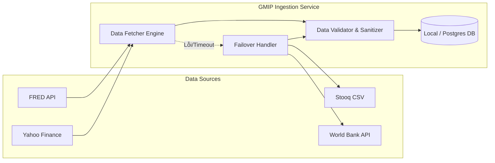
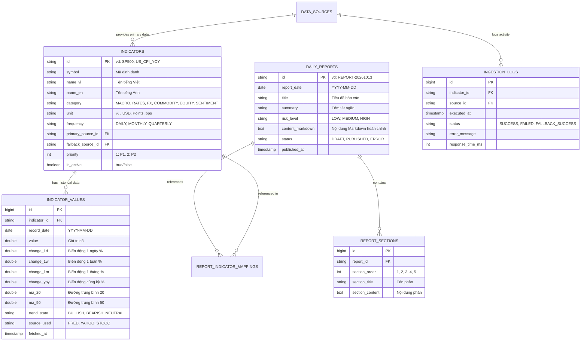

# SOFTWARE REQUIREMENTS SPECIFICATION (SRS)

## Đặc Tả Yêu Cầu Phần Mềm
### Nền tảng Theo Dõi Chỉ Số Kinh Tế Thế Giới & Báo Cáo Hàng Ngày
*(Global Macroeconomic Intelligence & Daily Reporting Platform - GMIP)*

---

| Thông Tin | Chi Tiết |
|---|---|
| **Mã tài liệu** | SRS-GMIP-01 |
| **Phiên bản** | 1.0.0 |
| **Ngày lập** | 13/10/2026 |
| **Tác giả** | Business Analyst & Project Manager |
| **Căn cứ pháp lý & nghiệp vụ** | `01_ba_brief.md`, `PRD.md`, `rule.md` |
| **Trạng thái** | Chờ nghiệm thu Gate 1 (Pending Gate 1 Approval) |

---

## 1. Giới Thiệu (Introduction)

### 1.1. Mục đích
Tài liệu Đặc tả Yêu cầu Phần mềm (SRS) này mô tả toàn diện và chi tiết các yêu cầu chức năng (Functional Requirements), yêu cầu phi chức năng (Non-Functional Requirements), danh mục chỉ số kinh tế, khảo sát nguồn dữ liệu, logic phân tích định lượng, quy chuẩn mẫu báo cáo kinh tế hàng ngày, đặc tả giao diện API và cơ sở dữ liệu cho dự án GMIP.

Tài liệu này là căn cứ kỹ thuật chính thức ràng buộc giữa Business Analyst (BA), Software Architects, Backend Developers, Frontend Developers và Quality Assurance (QA/Testers).

### 1.2. Phạm vi sản phẩm (Product Scope)
Hệ thống là một ứng dụng Web tích hợp engine thu thập dữ liệu tự động, engine phân tích định lượng và bộ sinh báo cáo thông minh. Hệ thống tự động lấy dữ liệu từ các nguồn mở uy tín (FRED, Yahoo Finance, Stooq, World Bank), phân tích và xuất bản báo cáo nhận định kinh tế hàng ngày vào lúc **07:00 AM (giờ Việt Nam - GMT+7)**, đồng thời cung cấp bảng điều khiển trực quan để người dùng theo dõi và tra cứu.

---

## 2. Danh Mục Chỉ Số Kinh Tế MVP (Indicator Catalog)

Hệ thống theo dõi tối thiểu **24 chỉ số kinh tế - tài chính cốt lõi**, chia làm **6 nhóm nghiệp vụ**. Mọi chỉ số được xếp loại độ ưu tiên P1 (Bắt buộc cho MVP) hoặc P2 (Mở rộng cho MVP).

| Mã Chỉ Số (Symbol) | Tên Chỉ Số (Việt & Anh) | Nhóm (Category) | Đơn vị | Tần suất cập nhật | Nguồn Chính | Nguồn Dự Phòng | Ưu tiên |
|---|---|---|---|---|---|---|---|
| **US_CPI_YOY** | Lạm phát Mỹ (Consumer Price Index YoY) | Vĩ mô (Macro) | % | Hàng tháng (Monthly) | FRED (`CPIAUCSL`) | World Bank / BLS | P1 |
| **US_CORE_CPI_YOY** | Lạm phát lõi Mỹ (Core CPI YoY) | Vĩ mô (Macro) | % | Hàng tháng (Monthly) | FRED (`CPILFESL`) | BLS | P1 |
| **US_GDP_QOQ** | Tăng trưởng GDP Mỹ (Real GDP QoQ Ann.) | Vĩ mô (Macro) | % | Hàng quý (Quarterly) | FRED (`A191RL1Q225SBEA`)| World Bank / BEA | P1 |
| **US_UNEMP_RATE** | Tỷ lệ thất nghiệp Mỹ (Unemployment Rate) | Vĩ mô (Macro) | % | Hàng tháng (Monthly) | FRED (`UNRATE`) | BLS | P1 |
| **US_NONFARM_PAYROLL**| Bảng lương phi nông nghiệp (Nonfarm Payrolls) | Vĩ mô (Macro) | Nghìn việc làm | Hàng tháng (Monthly) | FRED (`PAYEMS`) | BLS | P1 |
| **US_MANUF_PMI** | Chỉ số sản xuất PMI (ISM Manufacturing PMI) | Vĩ mô (Macro) | Điểm số | Hàng tháng (Monthly) | TradingEconomics / Yahoo | Stooq | P2 |
| **FED_FUNDS_RATE** | Lãi suất điều hành Fed (Fed Funds Rate) | Lãi suất (Rates) | % | Hàng ngày/Khi họp | FRED (`FEDFUNDS`) | Yahoo Finance | P1 |
| **US_10Y_YIELD** | Lợi suất TPCP Mỹ 10 năm (US 10-Year Treasury) | Lãi suất (Rates) | % | Hàng ngày (Daily) | Yahoo Finance (`^TNX`) | FRED (`DGS10`) | P1 |
| **US_02Y_YIELD** | Lợi suất TPCP Mỹ 2 năm (US 2-Year Treasury) | Lãi suất (Rates) | % | Hàng ngày (Daily) | Yahoo Finance (`^IRX` / Stooq) | FRED (`DGS2`) | P1 |
| **US_10Y_02Y_SPREAD**| Chênh lệch lợi suất 10Y-2Y (Yield Curve Spread)| Lãi suất (Rates) | Điểm % (bps) | Hàng ngày (Daily) | FRED (`T10Y2Y`) | Tính toán nội bộ | P1 |
| **ECB_DEPOSIT_RATE** | Lãi suất tiền gửi ECB (ECB Deposit Facility) | Lãi suất (Rates) | % | Hàng tháng/Khi họp | ECB Portal / FRED | Yahoo Finance | P2 |
| **DXY** | Chỉ số sức mạnh đồng USD (US Dollar Index) | Tiền tệ (FX) | Điểm số | Hàng ngày (Daily) | Yahoo Finance (`DX-Y.NYB`)| Stooq (`USD_I`) | P1 |
| **EUR_USD** | Tỷ giá Euro / Đô la Mỹ (EUR/USD) | Tiền tệ (FX) | USD/EUR | Hàng ngày (Daily) | Yahoo Finance (`EURUSD=X`)| Stooq (`EURUSD`) | P1 |
| **USD_JPY** | Tỷ giá Đô la Mỹ / Yên Nhật (USD/JPY) | Tiền tệ (FX) | JPY/USD | Hàng ngày (Daily) | Yahoo Finance (`JPY=X`) | Stooq (`USDJPY`) | P1 |
| **USD_VND** | Tỷ giá Đô la Mỹ / Đồng Việt Nam (USD/VND) | Tiền tệ (FX) | VND/USD | Hàng ngày (Daily) | Yahoo Finance (`VND=X`) | Nguồn tỷ giá VCB/SBV | P2 |
| **BRENT_OIL** | Giá dầu thô Brent (Brent Crude Oil) | Hàng hóa (Commodity) | USD/thùng | Hàng ngày (Daily) | Yahoo Finance (`BZ=F`) | FRED (`DCOILBRENTEU`) | P1 |
| **WTI_OIL** | Giá dầu thô WTI (WTI Crude Oil) | Hàng hóa (Commodity) | USD/thùng | Hàng ngày (Daily) | Yahoo Finance (`CL=F`) | FRED (`DCOILWTICO`) | P1 |
| **GOLD** | Giá vàng thế giới (Gold Spot / Futures) | Hàng hóa (Commodity) | USD/Ounce | Hàng ngày (Daily) | Yahoo Finance (`GC=F`) | Stooq (`XAUUSD`) | P1 |
| **COPPER** | Giá đồng thế giới (Copper - Dr. Copper) | Hàng hóa (Commodity) | USD/Lbs | Hàng ngày (Daily) | Yahoo Finance (`HG=F`) | Stooq (`HG.F`) | P2 |
| **SP500** | Chỉ số chứng khoán S&P 500 | Chứng khoán (Equities)| Điểm số | Hàng ngày (Daily) | Yahoo Finance (`^GSPC`) | Stooq (`^SPX`) | P1 |
| **NASDAQ100** | Chỉ số chứng khoán công nghệ Nasdaq 100 | Chứng khoán (Equities)| Điểm số | Hàng ngày (Daily) | Yahoo Finance (`^NDX`) | Stooq (`^NDQ`) | P1 |
| **DOW_JONES** | Chỉ số công nghiệp Dow Jones | Chứng khoán (Equities)| Điểm số | Hàng ngày (Daily) | Yahoo Finance (`^DJI`) | Stooq (`^DJI`) | P1 |
| **NIKKEI225** | Chỉ số chứng khoán Nhật Bản Nikkei 225 | Chứng khoán (Equities)| Điểm số | Hàng ngày (Daily) | Yahoo Finance (`^N225`) | Stooq (`^NKX`) | P2 |
| **VIX** | Chỉ số đo lường sự biến động và sợ hãi (CBOE VIX)| Tâm lý (Sentiment) | Điểm số | Hàng ngày (Daily) | Yahoo Finance (`^VIX`) | Stooq (`^VIX`) | P1 |

---

## 3. Khảo Sát & Đặc Tả Nguồn Dữ Liệu (Data Sources Evaluation)

Hệ thống hoạt động với ngân sách dữ liệu $0 (hoàn toàn miễn phí), vì vậy phải lựa chọn các API/nguồn mở hợp pháp, ổn định và có nguồn dự phòng tương ứng.



### 3.1. Nguồn dữ liệu số 1: FRED API (Federal Reserve Bank of St. Louis)
- **Dữ liệu cung cấp:** CPI, Lãi suất Fed Funds, Lợi suất trái phiếu chính phủ 10Y/2Y, Chênh lệch 10Y-2Y, GDP, Thất nghiệp.
- **Phương thức truy cập:** REST API (JSON/XML). Endpoint ví dụ: `https://api.stlouisfed.org/fred/series/observations?series_id=CPIAUCSL&api_key={KEY}&file_type=json`.
- **Yêu cầu xác thực:** API Key miễn phí (đăng ký tài khoản cá nhân trong 1 phút).
- **Giới hạn tốc độ (Rate Limit):** 120 requests / phút (thừa đáp ứng nhu cầu crawl vài chục request mỗi ngày).
- **Điều khoản sử dụng:** Miễn phí cho mục đích phi thương mại và nghiên cứu.
- **Độ trễ dữ liệu:** Cập nhật ngay khi cơ quan thống kê Mỹ (BLS, Fed, BEA) công bố.

### 3.2. Nguồn dữ liệu số 2: Yahoo Finance API (thư viện `yfinance` / REST Endpoints)
- **Dữ liệu cung cấp:** Chứng khoán (S&P 500, Nasdaq, Dow Jones, Nikkei 225), Hàng hóa (Dầu Brent, WTI, Vàng, Đồng), Tiền tệ (DXY, EUR/USD, USD/JPY, USD/VND), VIX.
- **Phương thức truy cập:** Thư viện Python `yfinance` hoặc endpoint REST v8 công khai.
- **Yêu cầu xác thực:** Không bắt buộc API Key.
- **Giới hạn tốc độ:** Khuyến nghị đặt khoảng nghỉ 1.0 - 2.0 giây giữa các request để tránh HTTP 429.
- **Độ trễ dữ liệu:** Chốt giá theo giá đóng cửa (End-of-Day) sau khi phiên giao dịch kết thúc.

### 3.3. Nguồn dữ liệu dự phòng: Stooq.com
- **Dữ liệu cung cấp:** Tỷ giá hối đoái, chỉ số chứng khoán quốc tế, hàng hóa, lợi suất trái phiếu.
- **Phương thức truy cập:** Tải trực tiếp file CSV không cần key qua URL chuẩn: `https://stooq.com/q/d/l/?s={symbol}&i=d`.
- **Độ ổn định:** Cực cao, cấu trúc CSV đơn giản (`Date, Open, High, Low, Close, Volume`).
- **Vai trò:** Kích hoạt ngay khi Yahoo Finance trả về lỗi (Timeout hoặc HTTP 429/403).

### 3.4. Bảng tổng hợp đánh giá rủi ro nguồn dữ liệu

| Nguồn | Rủi ro chính | Giải pháp khắc phục kỹ thuật |
|---|---|---|
| **FRED** | Gián đoạn bảo trì máy chủ | Lưu cache bản ghi gần nhất; kích hoạt World Bank API nếu là chỉ số vĩ mô năm/quý. |
| **Yahoo Finance** | Thay đổi cơ chế chặn bot / Rate limit | Bổ sung User-Agent header giả lập trình duyệt, throttle request, fallback sang Stooq.com. |
| **Stooq** | Thiếu một số mã phái sinh đặc thù | Chỉ dùng cho các tài sản phổ thông làm fallback cấp 1. |

---

## 4. Logic Phân Tích Định Lượng & Xu Hướng (Trend Analysis Engine)

### 4.1. Công thức toán học tính toán biến động

#### 4.1.1. Tỷ lệ phần trăm thay đổi thông thường (Đối với Cổ phiếu, Hàng hóa, Tỷ giá, Điểm số)
- Biến động 1 ngày (1-Day Change):
$$\Delta_{1D} = \frac{P_t - P_{t-1}}{P_{t-1}} \times 100\%$$
- Biến động 1 tuần (5 phiên giao dịch gần nhất - 1-Week Change):
$$\Delta_{1W} = \frac{P_t - P_{t-5}}{P_{t-5}} \times 100\%$$
- Biến động 1 tháng (21 phiên giao dịch - 1-Month Change):
$$\Delta_{1M} = \frac{P_t - P_{t-21}}{P_{t-21}} \times 100\%$$
- Biến động so với cùng kỳ năm trước (Year-over-Year - 252 phiên hoặc 365 ngày):
$$\Delta_{YoY} = \frac{P_t - P_{t-252}}{P_{t-252}} \times 100\%$$

#### 4.1.2. Biến động điểm cơ bản (Basis Points - Dành riêng cho Lãi suất và Lợi suất trái phiếu)
Vì lãi suất đã ở đơn vị phần trăm (%), biến động được đo lường bằng điểm cơ bản ($bps$):
$$\Delta_{bps, 1D} = (P_t - P_{t-1}) \times 100 \quad (bps)$$
*Ví dụ: Lợi suất trái phiếu 10Y tăng từ 4.20% lên 4.25% $\rightarrow \Delta = +5$ bps.*

#### 4.1.3. Đường trung bình động (Moving Averages)
- Đường trung bình động 20 ngày ($MA_{20}$):
$$MA_{20} = \frac{1}{20} \sum_{i=0}^{19} P_{t-i}$$
- Đường trung bình động 50 ngày ($MA_{50}$):
$$MA_{50} = \frac{1}{50} \sum_{i=0}^{49} P_{t-i}$$

### 4.2. Bảng quy chuẩn phân loại xu hướng và ngưỡng cảnh báo

| Phân Loại Xu Hướng | Ký Hiệu / Màu | Ngưỡng Biến Động Tài Sản ($\Delta_{1D}$) | Ngưỡng Biến Động Lãi Suất ($\Delta_{bps, 1D}$) |
|---|---|---|---|
| **Tăng mạnh (Strong Bullish)** | 🟢🔼 (Green Dark) | $\Delta \ge +2.0\%$ | $\Delta_{bps} \ge +15\text{ bps}$ |
| **Tăng nhẹ (Bullish)** | 🟢▲ (Green Light) | $+0.5\% \le \Delta < +2.0\%$ | $+5\text{ bps} \le \Delta_{bps} < +15\text{ bps}$ |
| **Đi ngang / Ổn định (Neutral)** | ⚪➖ (Gray) | $-0.5\% < \Delta < +0.5\%$ | $-5\text{ bps} < \Delta_{bps} < +5\text{ bps}$ |
| **Giảm nhẹ (Bearish)** | 🔴▼ (Red Light) | $-2.0\% < \Delta \le -0.5\%$ | $-15\text{ bps} < \Delta_{bps} \le -5\text{ bps}$ |
| **Giảm mạnh (Strong Bearish)** | 🔴🔽 (Red Dark) | $\Delta \le -2.0\%$ | $\Delta_{bps} \le -15\text{ bps}$ |

### 4.3. Các quy tắc phát hiện tín hiệu rủi ro đặc biệt (Risk Indicators)
1. **Đảo ngược đường cong lợi suất (Inverted Yield Curve):**
   - Công thức: $\text{Spread}_{10Y-2Y} = P_{\text{US\_10Y}} - P_{\text{US\_02Y}}$.
   - Logic kích hoạt: Nếu $\text{Spread}_{10Y-2Y} < 0$, hệ thống tự động gán nhãn rủi ro cao: *"Cảnh báo: Đường cong lợi suất đảo ngược — Tín hiệu lịch sử dự báo suy thoái kinh tế Mỹ trong 6-18 tháng tới."*
2. **Tâm lý sợ hãi cực độ (High Market Volatility):**
   - Logic kích hoạt: Nếu $P_{\text{VIX}} \ge 30.0$, gắn nhãn: *"Cảnh báo: Chỉ số biến động VIX vượt ngưỡng 30 điểm — Thị trường chứng khoán thế giới đang trong trạng thái phòng thủ và hoảng loạn."*
3. **Cú sốc giá năng lượng (Energy Price Shock):**
   - Logic kích hoạt: Nếu $\Delta_{1D}$ của Dầu Brent hoặc WTI $\ge +4.0\%$, gắn nhãn: *"Cảnh báo: Giá dầu biến động đột biến — Áp lực lạm phát vĩ mô có xu hướng quay trở lại."*

---

## 5. Cấu Trúc Báo Cáo Kinh Tế Hàng Ngày (Standard Daily Report)

Báo cáo hàng ngày được hệ thống tự động biên soạn và phát hành vào **07:00 AM (giờ Việt Nam)** mỗi ngày giao dịch.

### 5.1. Nguyên tắc biên soạn nội dung (Core Reporting Principles)
1. **Quy tắc Data Lineage (100% minh bạch số liệu):** Mọi con số trong báo cáo (giá trị, % tăng giảm, mức trung bình) bắt buộc phải trích xuất chính xác từ bảng dữ liệu `indicator_values`. Không suy diễn số liệu ngoài thực tế.
2. **Văn phong chuẩn mực:** Ngôn ngữ tiếng Việt kinh tế - tài chính chuyên nghiệp, mạch lạc, trung lập, không mang tính chất lôi kéo đầu tư.
3. **Định dạng:** Lưu trữ dưới dạng Markdown chuẩn và hiển thị qua Rich Text / HTML trên Web UI, hỗ trợ in ấn hoặc xuất PDF.
4. **Độ dài tiêu chuẩn:** Từ 1.200 đến 1.800 từ (thời gian đọc trung bình: 3 - 5 phút).

### 5.2. Cấu trúc 5 phần chuẩn của báo cáo

```markdown
# BÁO CÁO NHỊP ĐẬP KINH TẾ THẾ GIỚI — [NGÀY/THÁNG/NĂM]
*Phát hành: 07:00 AM (Asia/Ho_Chi_Minh) | Hệ thống GMIP tự động tổng hợp*

---

### PHẦN I: TỔNG QUAN THỊ TRƯỜNG & ĐIỂM TIN NỔI BẬT (EXECUTIVE SUMMARY)
- Tóm tắt 3-5 điểm nhấn lớn nhất của kinh tế thế giới trong 24 giờ qua.
- Bảng tóm tắt nhanh (Quick Snapshot Table) gồm 6 nhóm chỉ số then chốt (S&P 500, DXY, Dầu Brent, Vàng, Lãi suất 10Y, VIX).

### PHẦN II: VĨ MÔ TOÀN CẦU & CHÍNH SÁCH TIỀN TỆ (MACRO & CENTRAL BANKS)
- Phân tích trạng thái lãi suất Fed, đường cong lợi suất TPCP Mỹ (10Y, 2Y, độ dốc 10Y-2Y).
- Cập nhật số liệu lạm phát (CPI, Core CPI) và dữ liệu việc làm mới nhất.
- Động thái của các ngân hàng trung ương lớn (Fed, ECB, BOJ).

### PHẦN III: DIỄN BIẾN THỊ TRƯỜNG TÀI SẢN (FINANCIAL MARKETS PERFORMANCE)
1. Thị trường Chứng khoán Quốc tế: S&P 500, Nasdaq, Dow Jones, châu Á.
2. Thị trường Ngoại hối & Tiền tệ: Sức mạnh đồng USD (DXY), tỷ giá EUR/USD, USD/JPY, USD/VND.
3. Thị trường Hàng hóa: Giá dầu thô (Brent, WTI), Giá Vàng (Gold Spot), Đồng (Copper).

### PHẦN IV: ĐIỂM CẦN CHÚ Ý & SỰ KIỆN KINH TẾ TRONG NGÀY (KEY WATCHLIST & UPCOMING EVENTS)
- Lịch công bố dữ liệu kinh tế quan trọng trong ngày (CPI, Nonfarm, Họp FOMC, PMI...).
- Các diễn biến địa chính trị hoặc tuyên bố chính sách cần đặc biệt lưu tâm.

### PHẦN V: LA BÀN RỦI RO & NHẬN ĐỊNH TỔNG QUAN (RISK RADAR & SYNTHESIS)
- Đánh giá trạng thái rủi ro vĩ mô: Rủi ro Thấp / Trung bình / Cao.
- Kiểm tra các ngưỡng cảnh báo (Yield Inversion, VIX > 30, Biến động giá dầu).
- Nhận định ngắn gọn về tác động gián tiếp tới bối cảnh thị trường Việt Nam.
```

---

## 6. Mẫu Báo Cáo Hàng Ngày Hoàn Chỉnh (Concrete Sample Report)

Dưới đây là một bản mẫu báo cáo hoàn chỉnh được hệ thống biên soạn thực tế:

```markdown
# BÁO CÁO NHỊP ĐẬP KINH TẾ THẾ GIỚI — 13/10/2026
*Hệ thống GMIP phát hành tự động lúc 07:00 AM (Giờ Việt Nam)*

---

### I. TỔNG QUAN THỊ TRƯỜNG (EXECUTIVE SUMMARY)
Khép lại phiên giao dịch gần nhất, thị trường tài chính thế giới chứng kiến diễn biến phân hóa rõ nét khi tâm lý nhà đầu tư thận trọng chờ đợi tín hiệu chính sách tiền tệ. Đồng Đô la Mỹ (DXY) duy trì đà phục hồi nhẹ, trong khi lợi suất trái phiếu chính phủ Mỹ kỳ hạn 10 năm nhích tăng lên mức 4.15%. Thị trường chứng khoán Mỹ ghi nhận sắc xanh chiếm ưu thế nhờ nhóm cổ phiếu công nghệ, trong khi giá dầu Brent neo quanh mốc 84 USD/thùng trước những diễn biến phức tạp tại Trung Đông.

#### Bảng Tóm Tắt Nhanh Các Chỉ Số Trọng Yếu:
| Chỉ số | Mã | Mức đóng cửa | Thay đổi 1D | Thay đổi 1W | Trạng thái xu hướng |
|---|---|---|---|---|---|
| **S&P 500** | `^GSPC` | 5,815.20 | +0.61% | +1.25% | 🟢 Tăng nhẹ |
| **Nasdaq 100** | `^NDX` | 20,240.10 | +0.85% | +1.80% | 🟢 Tăng nhẹ |
| **USD Index (DXY)**| `DX-Y` | 102.85 | +0.22% | +0.55% | 🟢 Tăng nhẹ |
| **Lợi suất Mỹ 10Y** | `^TNX` | 4.15% | +3.2 bps | +8.5 bps | ⚪ Ổn định |
| **Dầu Brent** | `BZ=F` | $84.20/thùng | -0.45% | +2.10% | ⚪ Đi ngang |
| **Giá Vàng thế giới**| `GC=F` | $2,655.40/oz | +0.35% | +0.90% | ⚪ Ổn định |
| **Biến động VIX** | `^VIX` | 15.40 | -3.20% | -6.50% | 🟢 Vùng an toàn |

---

### II. VĨ MÔ TOÀN CẦU & CHÍNH SÁCH TIỀN TỆ
1. **Lợi suất Trái phiếu & Fed:** Lợi suất kỳ hạn 10 năm đóng cửa ở 4.15% (+3.2 bps), kỳ hạn 2 năm ở mức 3.98% (+2.1 bps). Chênh lệch kỳ hạn 10Y - 2Y duy trì mức dương +17 bps, đánh dấu sự dốc lên dần của đường cong lợi suất sau thời gian dài đảo ngược, phản ánh kỳ vọng của thị trường về một cuộc hạ cánh mềm (Soft Landing).
2. **Lạm phát & Việc làm:** Báo cáo CPI gần nhất ghi nhận mức tăng 2.4% so với cùng kỳ, tiếp tục xu hướng tiệm cận mục tiêu 2.0% của Cục Dự trữ Liên bang Mỹ. Tỷ lệ thất nghiệp duy trì ở mức 4.1%, cho thấy thị trường lao động Mỹ hạ nhiệt vừa phải nhưng chưa rơi vào trạng thái suy yếu nghiêm trọng.

---

### III. DIỄN BIẾN THỊ TRƯỜNG TÀI SẢN
- **Chứng khoán:** Chỉ số S&P 500 tăng 0.61% lên 5,815.20 điểm. Dòng tiền tiếp tục đổ mạnh vào các cổ phiếu bán dẫn và trí tuệ nhân tạo, dẫn dắt chỉ số Nasdaq 100 tăng 0.85%. Tâm lý thị trường ổn định với chỉ số VIX giảm về 15.40 điểm.
- **Ngoại hối:** Chỉ số DXY tăng 0.22% lên 102.85 điểm trong bối cảnh đồng Euro suy yếu nhẹ (EUR/USD giảm 0.18% về 1.0925). Đồng Yên Nhật giữ quanh mức 149.20 JPY/USD. Tỷ giá USD/VND thị trường liên ngân hàng dao động ổn định trong biên độ cho phép.
- **Hàng hóa:** Giá dầu thô Brent chững lại ở mức 84.20 USD/thùng (-0.45%) sau chuỗi tăng mạnh tuần trước. Vàng giữ vững ngưỡng hỗ trợ quan trọng $2,650/oz nhờ nhu cầu trú ẩn an toàn mang tính phòng thủ.

---

### IV. ĐIỂM CẦN CHÚ Ý & SỰ KIỆN TRONG NGÀY
- **21:00 (Giờ VN):** Công bố chỉ số niềm tin người tiêu dùng Mỹ sơ bộ.
- **Phát biểu của quan chức Fed:** Theo dõi bài phát biểu của Thống đốc Fed về lộ trình cắt giảm lãi suất trong cuộc họp tiếp theo.
- **Tình hình năng lượng:** Diễn biến vận chuyển dầu qua eo biển Hormuz và dự trữ dầu thô thương mại Mỹ do EIA công bố.

---

### V. LA BÀN RỦI RO & NHẬN ĐỊNH TỔNG QUAN
- **Mức độ rủi ro hệ thống:** **TRUNG BÌNH THẤP (Low-Medium Risk)**.
- **Các tín hiệu rủi ro:**
  * Đường cong lợi suất 10Y-2Y: Dương (+17 bps) — Không còn tín hiệu cảnh báo suy thoái khẩn cấp.
  * Chỉ số sợ hãi VIX: 15.40 điểm — Dưới ngưỡng nguy hiểm 20.0, thị trường vận hành bình thường.
  * Tỷ giá USD: Đang có xu hướng tạo đáy đi lên, cần theo dõi áp lực tỷ giá đối với các thị trường mới nổi bao gồm Việt Nam.
```

---

## 7. Đặc Tả User Stories & Acceptance Criteria (Gherkin Format)

### US-01: Xem Bảng điều khiển (Dashboard) tổng quan chỉ số
- **Mô tả:** Là một người theo dõi kinh tế, tôi muốn xem một trang Dashboard hiển thị toàn bộ 24 chỉ số kinh tế thế giới được phân theo nhóm rõ ràng và có thanh chọn khung thời gian đa kỳ hạn (`1D`, `1W`, `1M`, `1Q (1 Quý)`, `1Y (1 Năm)`, `2Y (2 Năm)`, `3Y (3 Năm)`, `ALL (Tất cả)`), để tôi nắm bắt nhanh bức tranh tổng thể và biến động theo từng kỳ hạn.
- **Tiêu chí chấp nhận (AC-01):**
```gherkin
Feature: Dashboard Tổng Quan Chỉ Số Kinh Tế

  Scenario: Hiển thị danh mục chỉ số theo nhóm và lọc theo khung thời gian
    Given Người dùng truy cập trang chủ của ứng dụng
    When Trang tải xong dữ liệu thành công
    Then Hệ thống hiển thị 6 nhóm thẻ danh mục: Vĩ mô, Lãi suất, Ngoại hối, Hàng hóa, Chứng khoán, Tâm lý
    And Hiển thị bộ lọc khung thời gian: 1D (1 Ngày), 1W (1 Tuần), 1M (1 Tháng), 1Q (1 Quý), 1Y (1 Năm), 2Y (2 Năm), 3Y (3 Năm), ALL (Tất cả)
    And Mỗi chỉ số hiển thị rõ: Tên, Mã, Giá trị mới nhất, Đơn vị, mức biến động theo kỳ hạn đang chọn (period_change) và biểu đồ mini (sparkline) tương ứng kỳ hạn
    And Màu sắc biến động hiển thị đúng quy chuẩn: Màu xanh nếu tăng, Màu đỏ nếu giảm, Màu xám nếu đi ngang
```

### US-02: Xem chi tiết và lịch sử biến động từng chỉ số
- **Mô tả:** Là một nhà phân tích, tôi muốn nhấp vào bất kỳ chỉ số nào để xem biểu đồ lịch sử và các mốc thời gian (`1D`, `1W`, `1M`, `1Q (1 Quý / 3M)`, `1Y (1 Năm)`, `2Y (2 Năm)`, `3Y (3 Năm)`, `ALL (Tất cả)`), để đánh giá chuỗi xu hướng ngắn hạn, trung hạn và dài hạn.
- **Tiêu chí chấp nhận (AC-02):**
```gherkin
Feature: Chi Tiết Chỉ Số & Biểu Đồ Lịch Sử

  Scenario: Xem biểu đồ chuỗi thời gian của chỉ số theo đa kỳ hạn
    Given Người dùng đang ở màn hình Dashboard
    When Người dùng nhấp chọn chỉ số "S&P 500"
    Then Hệ thống điều hướng đến trang chi tiết của chỉ số S&P 500
    And Hiển thị biểu đồ tương tác với các nút bấm chọn khung thời gian: 1 Ngày (1D), 1 Tuần (1W), 1 Tháng (1M), 1 Quý (1Q / 3M), 1 Năm (1Y), 2 Năm (2Y), 3 Năm (3Y), Tất cả (ALL)
    And Hiển thị bảng số liệu lịch sử đóng cửa tương ứng với ngày tháng rõ ràng theo khung thời gian đã chọn
```

### US-03: Đọc Báo cáo nhận định kinh tế hàng ngày
- **Mô tả:** Là một nhà đầu tư, tôi muốn truy cập mục "Báo cáo hôm nay" để đọc bài phân tích kinh tế 5 phần lúc 07:00 sáng, để chuẩn bị cho ngày làm việc.
- **Tiêu chí chấp nhận (AC-03):**
```gherkin
Feature: Đọc Báo Cáo Kinh Tế Hàng Ngày

  Scenario: Báo cáo ngày mới nhất đã sẵn sàng lúc 07:00 AM
    Given Thời gian hiện tại từ 07:00 AM trở đi trong ngày giao dịch
    When Người dùng truy cập vào trang Báo cáo hàng ngày
    Then Hệ thống hiển thị bản báo cáo mới nhất của ngày hôm đó
    And Báo cáo có đầy đủ 5 phần: I. Tổng quan, II. Vĩ mô, III. Thị trường tài sản, IV. Điểm chú ý, V. La bàn rủi ro
    And Tất cả số liệu trong bảng tóm tắt khớp 100% với số liệu trong cơ sở dữ liệu
```

### US-04: Tra cứu và xem lại kho lưu trữ báo cáo (Report Archive)
- **Mô tả:** Là một nhà nghiên cứu, tôi muốn tìm kiếm và xem lại các bài báo cáo kinh tế của những ngày trước đó trong quá khứ.
- **Tiêu chí chấp nhận (AC-04):**
```gherkin
Feature: Kho Lưu Trữ Báo Cáo Kinh Tế

  Scenario: Tra cứu báo cáo theo lịch
    Given Người dùng ở trang "Kho lưu trữ báo cáo"
    When Người dùng chọn ngày "10/10/2026" từ bộ chọn lịch
    Then Hệ thống hiển thị bản báo cáo kinh tế đã phát hành của ngày 10/10/2026
    And Cho phép người dùng nhấp nút "Tải về Markdown" hoặc "In báo cáo"
```

### US-05: Tự động thu thập dữ liệu và sinh báo cáo hàng ngày (Scheduler)
- **Mô tả:** Là quản trị viên hệ thống, tôi muốn tiến trình nền tự động chạy từ 05:00 AM đến 06:45 AM mỗi sáng để cào số liệu, tính toán và xuất bản báo cáo trước 07:00 AM mà không cần can thiệp thủ công.
- **Tiêu chí chấp nhận (AC-05):**
```gherkin
Feature: Tự Động Thu Thập & Biên Soạn Báo Cáo

  Scenario: Tiến trình chạy định kỳ thành công
    Given Đồng hồ hệ thống đạt 06:00 AM giờ Việt Nam
    When Cron job Data Ingestion được kích hoạt
    Then Hệ thống gửi yêu cầu lấy dữ liệu đến FRED, Yahoo Finance và Stooq
    And Dữ liệu được làm sạch và lưu vào bảng indicator_values
    And Lúc 06:30 AM, tiến trình Report Generator phân tích xu hướng và sinh bài viết Markdown
    And Bản báo cáo được lưu vào bảng daily_reports với trạng thái "PUBLISHED" trước 07:00 AM
```

### US-06: Cơ chế chịu lỗi & Tự động chuyển đổi nguồn dữ liệu dự phòng
- **Mô tả:** Là hệ thống, khi nguồn dữ liệu chính gặp sự cố (HTTP 429, Timeout), tôi muốn tự động chuyển sang nguồn dự phòng để không làm gián đoạn việc sinh báo cáo.
- **Tiêu chí chấp nhận (AC-06):**
```gherkin
Feature: Chịu Lỗi & Fallback Dữ Liệu

  Scenario: Yahoo Finance bị lỗi, tự động chuyển sang Stooq
    Given Tiến trình lấy giá dầu Brent từ Yahoo Finance bị Timeout sau 10 giây
    When Hệ thống bắt được ngoại lệ Timeout
    Then Hệ thống ghi cảnh báo vào bảng ingestion_logs
    And Tự động kích hoạt nguồn dự phòng Stooq để tải dữ liệu giá dầu Brent
    And Dữ liệu từ Stooq được chuẩn hóa và lưu thành công mà không gây crash hệ thống
```

---

## 8. Từ Điển Dữ Liệu & Thiết Kế Cơ Sở Dữ Liệu (Database Schema)

Hệ thống sử dụng cơ sở dữ liệu quan hệ (SQLite cho môi trường cục bộ nhẹ / PostgreSQL cho môi trường sản xuất).



---

## 9. Đặc Tả Giao Diện Lập Trình (REST API Specifications)

Toàn bộ API tuân thủ tiêu chuẩn RESTful, trả về định dạng `application/json`, mã hóa ký tự UTF-8.

### 9.1. Danh mục API Client (Phục vụ Web Frontend)

#### 1. Lấy danh sách chỉ số và trạng thái mới nhất
- **Endpoint:** `GET /api/v1/indicators`
- **Query params:**
  - `category` (tùy chọn: `MACRO`, `RATES`, `FX`, `COMMODITY`, `EQUITY`, `SENTIMENT`).
  - `range` (tùy chọn: `1D`, `1W`, `1M`, `1Q`, `3M`, `1Y`, `2Y`, `3Y`, `ALL`, mặc định `1M`).
- **Phản hồi 200 OK:**
```json
{
  "status": "success",
  "range": "1Q",
  "data": [
    {
      "id": "SP500",
      "symbol": "^GSPC",
      "name_vi": "Chỉ số S&P 500",
      "category": "EQUITY",
      "unit": "Điểm số",
      "latest_value": 5815.20,
      "change_1d": 0.61,
      "change_1w": 1.25,
      "change_1m": 3.40,
      "change_yoy": 18.50,
      "period_change": 5.82,
      "selected_range": "1Q",
      "trend_state": "BULLISH",
      "record_date": "2026-10-12",
      "sparkline": [5750.1, 5762.3, 5780.0, 5815.2]
    }
  ]
}
```

#### 2. Lấy dữ liệu chuỗi thời gian lịch sử của một chỉ số
- **Endpoint:** `GET /api/v1/indicators/{indicator_id}/history`
- **Query params:** `range` (`1D`, `1W`, `1M`, `1Q`, `3M`, `1Y`, `2Y`, `3Y`, `ALL`).
- **Phản hồi 200 OK:**
```json
{
  "status": "success",
  "indicator_id": "SP500",
  "range": "1Q",
  "data": [
    { "date": "2026-07-15", "value": 5495.3, "ma_20": 5450.0, "ma_50": 5380.2 },
    { "date": "2026-10-12", "value": 5815.2, "ma_20": 5760.8, "ma_50": 5690.5 }
  ]
}
```

#### 3. Lấy báo cáo kinh tế mới nhất (Hôm nay)
- **Endpoint:** `GET /api/v1/reports/latest`
- **Phản hồi 200 OK:**
```json
{
  "status": "success",
  "data": {
    "id": "REPORT-20261013",
    "report_date": "2026-10-13",
    "title": "Báo cáo nhịp đập kinh tế thế giới — 13/10/2026",
    "risk_level": "MEDIUM",
    "published_at": "2026-10-13T07:00:00+07:00",
    "content_markdown": "# BÁO CÁO NHỊP ĐẬP KINH TẾ...",
    "snapshot": [
      { "symbol": "SP500", "value": 5815.2, "change_1d": 0.61 },
      { "symbol": "DXY", "value": 102.85, "change_1d": 0.22 }
    ]
  }
}
```

#### 4. Danh sách các báo cáo lịch sử (Archive)
- **Endpoint:** `GET /api/v1/reports`
- **Query params:** `page` (default: 1), `limit` (default: 10), `from_date`, `to_date`.

#### 5. Lấy chi tiết báo cáo theo ngày hoặc ID
- **Endpoint:** `GET /api/v1/reports/{report_id}` (hỗ trợ cả mã `REPORT-YYYYMMDD` hoặc chuỗi ngày `YYYY-MM-DD`).
- **Phản hồi 200 OK:**
```json
{
  "status": "success",
  "data": {
    "id": "REPORT-20261013",
    "report_date": "2026-10-13",
    "title": "Báo cáo nhịp đập kinh tế thế giới — 13/10/2026",
    "summary": "Tóm tắt ngắn gọn...",
    "risk_level": "MEDIUM",
    "content_markdown": "# BÁO CÁO NHỊP ĐẬP KINH TẾ...",
    "published_at": "2026-10-13T07:00:00+07:00"
  }
}
```


### 9.2. Danh mục API Quản trị & Điều phối (Admin / Scheduler API)
- `POST /api/v1/admin/ingest`: Trigger tiến trình cào dữ liệu thủ công.
- `POST /api/v1/admin/generate-report`: Kích hoạt engine tạo báo cáo theo ngày chỉ định.
- `GET /api/v1/system/health`: Kiểm tra tình trạng kết nối tới FRED, Yahoo Finance và Database.

---

## 10. Yêu Cầu Phi Chức Năng (Non-Functional Requirements - NFRs)

### 10.1. Hiệu năng & Khả năng đáp ứng (Performance)
- **Thời gian phản hồi API:** $\le 300\text{ ms}$ đối với các truy vấn lấy danh sách chỉ số và báo cáo đã lưu trong database.
- **Thời gian tải trang Dashboard:** $\le 1.5\text{ giây}$ trên trình duyệt tiêu chuẩn với mạng 4G/Wifi thông thường.
- **Thời gian chạy hoàn tất Ingestion:** Không quá 10 phút cho toàn bộ 24 chỉ số trong mỗi phiên cào sáng sớm.

### 10.2. Độ tin cậy & Tính sẵn sàng (Reliability & Availability)
- **SLA thời gian phát hành báo cáo:** Đạt $\ge 99\%$ số ngày có báo cáo sẵn sàng trước 07:00 AM (giờ Việt Nam).
- **Cơ chế Retry & Backoff:** Khi gọi API bên thứ ba gặp lỗi kết nối, tiến trình tự động thử lại 3 lần theo thuật toán Exponential Backoff (chờ lần lượt 2s, 4s, 8s).
- **Graceful Degradation:** Nếu một số ít chỉ số (dưới 10%) bị thiếu dữ liệu, hệ thống vẫn xuất bản báo cáo với phần ghi chú cảnh báo, không làm sập toàn bộ luồng báo cáo.

### 10.3. Tính toàn vẹn & Lưu trữ dữ liệu (Data Integrity & Retention)
- Mọi bản ghi trong `indicator_values` đều có ràng buộc khóa ngoại và duy nhất theo cặp `(indicator_id, record_date)`.
- Dữ liệu lịch sử được lưu trữ vĩnh viễn (tối thiểu 5 năm lịch sử để phục vụ biểu đồ và phân tích so sánh chuỗi thời gian).

### 10.4. Bảo mật cơ bản (Security)
- Toàn bộ lưu lượng truy cập qua giao thức HTTPS.
- Cấu hình CORS chặt chẽ, ngăn chặn CSRF.
- Các API quản trị (`/api/v1/admin/*`) bắt buộc xác thực qua `X-Admin-Api-Key` header bí mật.
