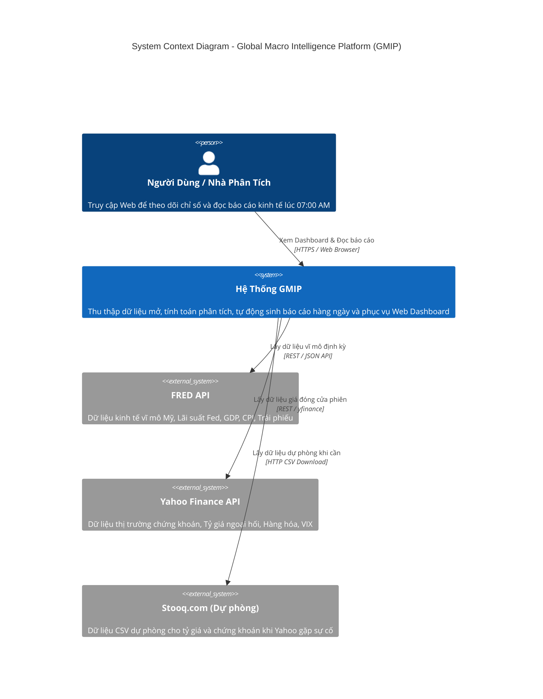
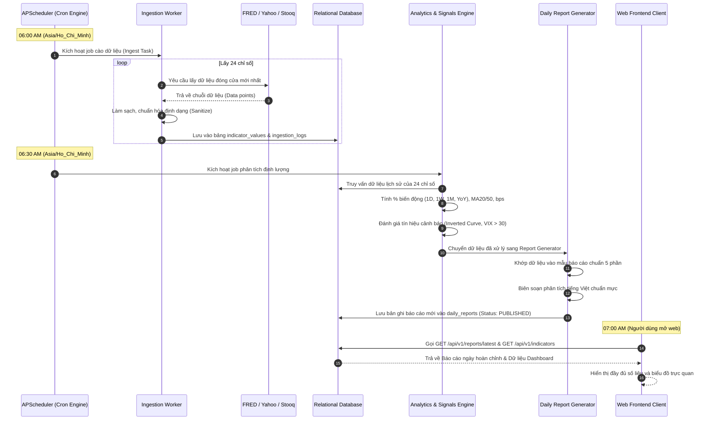
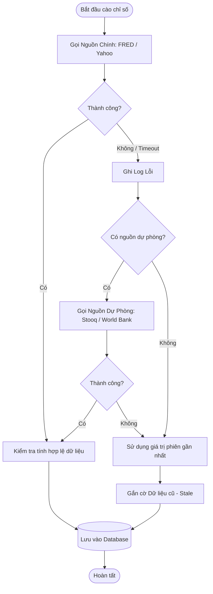

# TECHNICAL ARCHITECTURE DOCUMENT (TECH_ARCHITECTURE.md)

## Kiến Trúc Kỹ Thuật Hệ Thống
### Nền tảng Theo Dõi Chỉ Số Kinh Tế Thế Giới & Báo Cáo Hàng Ngày
*(Global Macroeconomic Intelligence & Daily Reporting Platform - GMIP)*

---

| Thuộc Tính | Chi Tiết |
|---|---|
| **Mã tài liệu** | ARCH-GMIP-01 |
| **Phiên bản** | 1.0.0 |
| **Ngày ban hành** | 13/10/2026 |
| **Kiến trúc sư trưởng / PM** | Project Manager & Tech Lead |
| **Căn cứ nghiệp vụ** | `docs/PRD.md`, `docs/SRS.md`, `01_ba_brief.md` |
| **Trạng thái** | Chính thức (Approved for Implementation) |

---

## 1. Cấu Trúc Tổng Thể Thư Mục Dự Án (Project Structure)

Dự án được cấu trúc theo mô hình phân tách tầng độc lập, rõ ràng giữa Backend (Service xử lý dữ liệu, phân tích & API) và Frontend (Giao diện Web hiển thị Dashboard & Báo cáo), kèm theo thư mục dùng chung và tài liệu dự án:

```
workstuff_management_platform/
├── backend/                        # Toàn bộ mã nguồn phía máy chủ và phân tích dữ liệu
│   ├── app/
│   │   ├── __init__.py
│   │   ├── main.py                 # Điểm khởi chạy FastAPI application
│   │   ├── config.py               # Quản lý cấu hình, biến môi trường (Settings)
│   │   ├── api/                    # Tầng API Routers & Controllers
│   │   │   ├── __init__.py
│   │   │   ├── v1/
│   │   │   │   ├── indicators.py   # API lấy danh sách và lịch sử chỉ số
│   │   │   │   ├── reports.py      # API lấy báo cáo ngày và kho lưu trữ
│   │   │   │   └── admin.py        # API trigger crawl & generate báo cáo thủ công
│   │   ├── core/                   # Các module xử lý logic nghiệp vụ cốt lõi
│   │   │   ├── ingestion/          # Engine thu thập dữ liệu đa nguồn
│   │   │   │   ├── base.py         # Abstract base fetcher & data normalizer
│   │   │   │   ├── fred.py         # Fetcher chuyên biệt cho FRED API
│   │   │   │   ├── yahoo.py        # Fetcher chuyên biệt cho Yahoo Finance
│   │   │   │   ├── stooq.py        # Fetcher dự phòng Stooq (CSV Parser)
│   │   │   │   └── fallback.py     # Bộ điều phối chuyển nguồn dự phòng (Circuit breaker)
│   │   │   ├── analytics/          # Động cơ phân tích định lượng
│   │   │   │   ├── calculator.py   # Tính toán 1D, 1W, 1M, YoY, MA20, MA50, bps
│   │   │   │   └── signals.py      # Bộ nhận diện tín hiệu (Inverted curve, VIX, Trend)
│   │   │   └── reporting/          # Động cơ biên soạn báo cáo kinh tế tự động
│   │   │       ├── generator.py    # Biên soạn báo cáo 5 phần Markdown tự động
│   │   │       └── templates.py    # Các template và mẫu câu nhận định tiếng Việt
│   │   ├── db/                     # Tầng tương tác Cơ sở dữ liệu
│   │   │   ├── database.py         # Cấu hình kết nối SQLAlchemy / Engine
│   │   │   ├── models.py           # Định nghĩa ORM Models
│   │   │   └── schemas.py          # Pydantic schemas (Request/Response DTOs)
│   │   └── scheduler/              # Bộ lập lịch tác vụ tự động
│   │       └── cron_jobs.py        # Lập lịch 06:00 AM (Ingestion) & 06:30 AM (Reporting)
│   ├── tests/                      # Bộ kiểm thử Unit & Integration Backend
│   │   ├── test_fetchers.py
│   │   ├── test_calculator.py
│   │   ├── test_generator.py
│   │   └── test_api.py
│   ├── requirements.txt            # Danh sách thư viện Python
│   └── Dockerfile                  # Container đóng gói Backend
│
├── frontend/                       # Mã nguồn giao diện người dùng Web
│   ├── src/
│   │   ├── assets/                 # Icons, hình ảnh minh họa
│   │   ├── components/             # Các UI Components tái sử dụng
│   │   │   ├── common/             # Navbar, Footer, LoadingSpinner, ErrorAlert
│   │   │   ├── dashboard/          # MetricCard, CategorySection, SparklineChart
│   │   │   ├── charts/             # Biểu đồ chuỗi thời gian tương tác (Interactive Chart)
│   │   │   └── report/             # MarkdownViewer, ReportHeader, RiskBadge
│   │   ├── pages/                  # Các màn hình chính của ứng dụng
│   │   │   ├── DashboardPage       # Trang chủ tổng quan 24 chỉ số
│   │   │   ├── IndicatorDetailPage # Trang chi tiết và lịch sử một chỉ số
│   │   │   ├── DailyReportPage     # Trang đọc báo cáo mới nhất hôm nay
│   │   │   └── ArchivePage         # Trang kho lưu trữ tra cứu báo cáo cũ
│   │   ├── services/               # Tầng gọi API Backend (HTTP Client)
│   │   └── styles/                 # Theme, bảng màu tài chính (Green/Red/Dark mode)
│   ├── package.json
│   └── Dockerfile                  # Container đóng gói Frontend
│
├── docs/                           # Bộ tài liệu dự án chính thức
│   ├── PRD.md                      # Product Requirements Document
│   ├── SRS.md                      # Software Requirements Specification
│   ├── TECH_ARCHITECTURE.md        # Tài liệu Kiến trúc này
│   └── PLAN.md                     # Kế hoạch triển khai & Phân công nhiệm vụ
├── docker-compose.yml              # Điều phối toàn bộ hệ thống bằng 1 lệnh
└── README.md                       # Hướng dẫn khởi động & đóng góp
```

---

## 2. Sơ Đồ Kiến Trúc Hệ Thống Cấp Cao (High-Level Architecture Diagrams)

### 2.1. Sơ đồ Ngữ cảnh Hệ thống (C4 Context Diagram)



### 2.2. Sơ đồ Luồng Dữ Liệu Xử Lý Tự Động Hàng Ngày (Daily Pipeline Lifecycle)



---

## 3. Các Thành Phần Cốt Lõi Của Hệ Thống (Core System Components)

### 3.1. Frontend Application (Web Client)
- **Công nghệ lựa chọn:** Next.js / React (hoặc Flutter Web trên nền tảng sẵn có của repo) hỗ trợ Responsive Web trên cả Desktop, Tablet và Mobile.
- **Trách nhiệm chính:**
  * Hiển thị bảng điều khiển Dashboard chia làm 6 khối: Vĩ mô, Lãi suất, Ngoại hối, Hàng hóa, Chứng khoán, Tâm lý thị trường.
  * Hiển thị trạng thái màu sắc theo quy tắc: Xanh (Tăng), Đỏ (Giảm), Xám (Đi ngang) cùng mini sparklines.
  * Tích hợp thư viện biểu đồ chuỗi thời gian (Chart.js / Recharts) cho phép zoom, hover tooltip, đổi khung thời gian 1W, 1M, 1Y, ALL.
  * Tích hợp Markdown Reader hiển thị các bản báo cáo kinh tế hàng ngày với typography chuẩn tạp chí tài chính.
  * Hỗ trợ bộ lọc ngày (Calendar Picker) để tra cứu lịch sử báo cáo.

### 3.2. Backend API Service (FastAPI)
- **Công nghệ lựa chọn:** Python 3.11+, FastAPI (Uvicorn ASGI Server).
- **Lý do lựa chọn:**
  * Hệ sinh thái Python là tiêu chuẩn vàng trong xử lý dữ liệu tài chính vĩ mô (`pandas`, `numpy`, `yfinance`, `fredapi`).
  * FastAPI cung cấp tốc độ phản hồi cực nhanh, tự động sinh tài liệu chuẩn OpenAPI/Swagger (`/docs`).
  * Khả năng lập lịch tác vụ bất đồng bộ dễ dàng với `APScheduler`.
- **Trách nhiệm chính:**
  * Cung cấp các RESTful API endpoints an toàn, nhanh chóng cho Frontend.
  * Quản lý kết nối cơ sở dữ liệu, caching trong bộ nhớ để phản hồi dưới 100ms.

### 3.3. Data Ingestion Service (Bộ thu thập dữ liệu tự động)
- **Trách nhiệm chính:**
  * Điều phối việc gửi request định kỳ tới FRED API và Yahoo Finance API.
  * **Cơ chế Chống chặn (Rate Limiting & Anti-Ban):** Tự động nghỉ giữa các request (throttle 1.0 - 1.5 giây), thiết lập User-Agent xoay vòng.
  * **Cơ chế Dự phòng (Failover / Circuit Breaker):** Khi Yahoo Finance gặp lỗi (HTTP 429/500 hoặc Timeout > 10s), tự động kích hoạt Stooq CSV Fetcher để lấy dữ liệu thay thế mà không gây dừng tiến trình.

### 3.4. Trend Analysis & Signal Engine (Bộ phân tích định lượng)
- **Trách nhiệm chính:**
  * Sử dụng thư viện `pandas` để tính toán ma trận dữ liệu chuỗi thời gian:
    - Biến động tương đối: 1 ngày ($\Delta_{1D}$), 1 tuần ($\Delta_{1W}$), 1 tháng ($\Delta_{1M}$), cùng kỳ năm trước ($\Delta_{YoY}$).
    - Biến động tuyệt đối theo điểm cơ bản ($bps$) cho lợi suất trái phiếu và lãi suất liên ngân hàng.
    - Đường trung bình động $MA_{20}$ và $MA_{50}$.
  * Kiểm tra và gắn nhãn các chỉ báo rủi ro vĩ mô: Đảo ngược đường cong lợi suất ($10Y - 2Y < 0$), Chỉ số sợ hãi VIX vượt 30 điểm.

### 3.5. Automated Report Generation Engine (Bộ sinh báo cáo tự động)
- **Trách nhiệm chính:**
  * Sử dụng Template Engine kết hợp dữ liệu định lượng đã tính toán.
  * Biên soạn bài viết phân tích 5 phần bằng tiếng Việt theo phong cách tài chính chuẩn mực.
  * Thực thi quy tắc **Data Lineage (100% truy vết số liệu)**: Đảm bảo mọi con số xuất hiện trong bài viết đều có bản ghi nguồn đối ứng.
  * Xuất bản báo cáo với trạng thái `PUBLISHED` trước 07:00 AM mỗi ngày.

---

## 4. Thiết Kế Cơ Sở Dữ Liệu (Data Store Architecture)

### 4.1. Hệ quản trị CSDL
- **Phát triển / Môi trường cá nhân nhẹ:** SQLite (lưu file cục bộ, không cần cài đặt phức tạp, cực kỳ bền bỉ và di động).
- **Môi trường Server / Production:** PostgreSQL 15+ (tương thích 100% nhờ lớp trừu tượng SQLAlchemy ORM).

### 4.2. Lược đồ DDL Chi Tiết (Database Schema SQL)

```sql
-- 1. Bảng danh mục nguồn dữ liệu
CREATE TABLE data_sources (
    id VARCHAR(32) PRIMARY KEY,
    name VARCHAR(128) NOT NULL,
    base_url VARCHAR(255) NOT NULL,
    auth_type VARCHAR(32) DEFAULT 'NONE', -- 'API_KEY', 'NONE', 'BEARER'
    rate_limit_per_minute INT DEFAULT 60,
    is_active BOOLEAN DEFAULT TRUE,
    created_at TIMESTAMP DEFAULT CURRENT_TIMESTAMP
);

-- 2. Bảng định nghĩa danh mục chỉ số kinh tế
CREATE TABLE indicators (
    id VARCHAR(64) PRIMARY KEY, -- vd: 'SP500', 'US_CPI_YOY', 'US_10Y_YIELD'
    symbol VARCHAR(64) NOT NULL,
    name_vi VARCHAR(255) NOT NULL,
    name_en VARCHAR(255) NOT NULL,
    category VARCHAR(32) NOT NULL, -- 'MACRO', 'RATES', 'FX', 'COMMODITY', 'EQUITY', 'SENTIMENT'
    unit VARCHAR(32) NOT NULL, -- '%', 'USD', 'Points', 'bps'
    frequency VARCHAR(32) DEFAULT 'DAILY', -- 'DAILY', 'MONTHLY', 'QUARTERLY'
    primary_source_id VARCHAR(32) REFERENCES data_sources(id),
    fallback_source_id VARCHAR(32) REFERENCES data_sources(id),
    priority INT DEFAULT 1, -- 1: P1, 2: P2
    is_active BOOLEAN DEFAULT TRUE,
    created_at TIMESTAMP DEFAULT CURRENT_TIMESTAMP
);

-- 3. Bảng lưu trữ giá trị lịch sử và chỉ số phân tích
CREATE TABLE indicator_values (
    id BIGSERIAL PRIMARY KEY,
    indicator_id VARCHAR(64) NOT NULL REFERENCES indicators(id) ON DELETE CASCADE,
    record_date DATE NOT NULL,
    value DOUBLE PRECISION NOT NULL,
    change_1d DOUBLE PRECISION,
    change_1w DOUBLE PRECISION,
    change_1m DOUBLE PRECISION,
    change_yoy DOUBLE PRECISION,
    ma_20 DOUBLE PRECISION,
    ma_50 DOUBLE PRECISION,
    trend_state VARCHAR(32), -- 'STRONG_BULLISH', 'BULLISH', 'NEUTRAL', 'BEARISH', 'STRONG_BEARISH'
    source_used VARCHAR(32) NOT NULL,
    fetched_at TIMESTAMP DEFAULT CURRENT_TIMESTAMP,
    CONSTRAINT uq_indicator_date UNIQUE (indicator_id, record_date)
);

-- 4. Bảng lưu trữ các bản báo cáo kinh tế hàng ngày
CREATE TABLE daily_reports (
    id VARCHAR(64) PRIMARY KEY, -- vd: 'REPORT-20261013'
    report_date DATE NOT NULL UNIQUE,
    title VARCHAR(255) NOT NULL,
    summary TEXT,
    risk_level VARCHAR(32) DEFAULT 'MEDIUM', -- 'LOW', 'MEDIUM', 'HIGH'
    content_markdown TEXT NOT NULL,
    status VARCHAR(32) DEFAULT 'PUBLISHED', -- 'DRAFT', 'PUBLISHED', 'FAILED'
    created_at TIMESTAMP DEFAULT CURRENT_TIMESTAMP,
    published_at TIMESTAMP
);

-- 5. Bảng ghi log nhật ký thu thập dữ liệu
CREATE TABLE ingestion_logs (
    id BIGSERIAL PRIMARY KEY,
    indicator_id VARCHAR(64) REFERENCES indicators(id),
    source_id VARCHAR(32) REFERENCES data_sources(id),
    status VARCHAR(32) NOT NULL, -- 'SUCCESS', 'FAILED', 'FALLBACK_SUCCESS'
    response_time_ms INT,
    error_message TEXT,
    executed_at TIMESTAMP DEFAULT CURRENT_TIMESTAMP
);

-- Các chỉ mục tối ưu hóa tốc độ truy vấn (Indexing Strategy)
CREATE INDEX idx_indicator_values_query ON indicator_values (indicator_id, record_date DESC);
CREATE INDEX idx_daily_reports_date ON daily_reports (report_date DESC);
CREATE INDEX idx_ingestion_logs_date ON ingestion_logs (executed_at DESC);
```

---

## 5. Tích Hợp Bên Ngoài & Khả Năng Chịu Lỗi (External Resiliency Architecture)



### Chiến lược kiểm soát lỗi:
1. **Timeout Chặt Chẽ:** Giới hạn mỗi HTTP Request tối đa **10 giây**.
2. **Backoff Thử Lại:** Thử lại tối đa 3 lần với khoảng cách $2^n$ giây ($2s, 4s, 8s$) trước khi chuyển sang nguồn dự phòng.
3. **Data Sanity Check (Kiểm tra rác):**
   * Giá trị không được rỗng hoặc NaN.
   * Giá trị không được âm đối với các chỉ số bắt buộc dương (Giá dầu, Vàng, Cổ phiếu).
   * Giá trị biến động không vượt quá $\pm 50\%$ trong 1 ngày (tránh lỗi nguồn nhập sai số thập phân).

---

## 6. Môi Trường Triển Khai & Đóng Gói (Deployment & Infrastructure)

### 6.1. Triển khai chuẩn hóa với Docker Compose
Toàn bộ hệ thống được đóng gói gọn trong file `docker-compose.yml`, cho phép chạy toàn bộ hệ thống bằng một câu lệnh: `docker compose up -d`.

```yaml
version: '3.8'

services:
  backend:
    build:
      context: ./backend
      dockerfile: Dockerfile
    container_name: gmip_backend
    restart: always
    environment:
      - PORT=8000
      - ENVIRONMENT=production
      - DATABASE_URL=sqlite:////app/data/gmip.db
      - FRED_API_KEY=${FRED_API_KEY}
      - CRON_INGESTION_TIME=06:00
      - CRON_REPORT_TIME=06:30
      - TIMEZONE=Asia/Ho_Chi_Minh
    volumes:
      - ./backend/data:/app/data
    ports:
      - "8000:8000"

  frontend:
    build:
      context: ./frontend
      dockerfile: Dockerfile
    container_name: gmip_frontend
    restart: always
    environment:
      - NEXT_PUBLIC_API_URL=http://backend:8000/api/v1
    ports:
      - "3000:3000"
    depends_on:
      - backend
```

---

## 7. Giám Sát, Ghi Log & Bảo Mật (Observability & Security)

### 7.1. Ghi log có cấu trúc (Structured Logging)
- Sử dụng chuẩn JSON Logging trong Python Backend với các trường: `timestamp`, `level`, `module`, `indicator_id`, `execution_time_ms`, `message`.
- Toàn bộ ngoại lệ từ quá trình cào dữ liệu được ghi vào bảng `ingestion_logs` để dễ dàng kiểm tra qua API `/api/v1/system/health`.

### 7.2. Bảo mật ứng dụng
- **Quản lý biến môi trường:** Khóa bí mật `FRED_API_KEY`, `ADMIN_SECRET_KEY` được đọc từ file `.env`, tuyệt đối không commit lên Git.
- **Bảo vệ API Quản trị:** Các endpoint can thiệp hệ thống (`/api/v1/admin/*`) yêu cầu kiểm tra token bí mật trong header `X-Admin-Api-Key`.
- **Cấu hình CORS:** Chỉ cho phép Frontend domain gửi request tới Backend.

---

## 8. Từ Điển Thuật Ngữ Kỹ Thuật (Technical Glossary)

- **bps (Basis Points):** Điểm cơ bản trong tài chính ($1\text{ bps} = 0.01\%$).
- **Inverted Yield Curve:** Hiện tượng lợi suất trái phiếu ngắn hạn cao hơn dài hạn ($10Y - 2Y < 0$), chỉ báo kinh điển về nguy cơ suy thoái kinh tế.
- **VIX (CBOE Volatility Index):** Chỉ số đo lường mức độ biến động kỳ vọng của thị trường chứng khoán trong 30 ngày tới.
- **Data Lineage:** Khả năng truy xuất ngược nguồn gốc dữ liệu từ bản báo cáo tổng hợp về đến từng bản ghi thô ban đầu.
- **Failover / Fallback:** Cơ chế tự động chuyển đổi sang nguồn dự phòng khi nguồn chính gặp lỗi.
